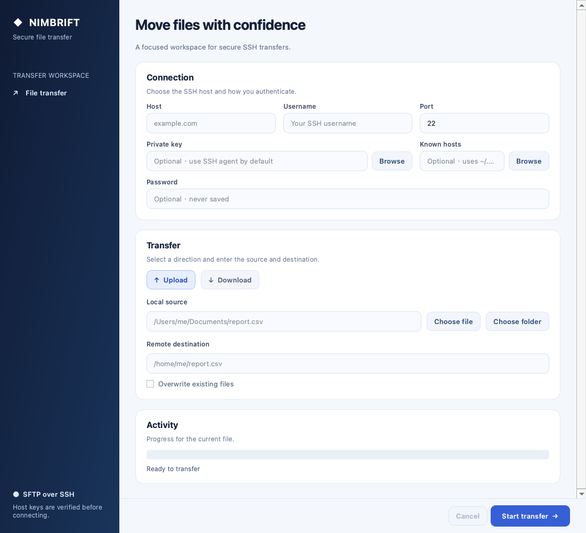

# Nimbrift

Nimbrift 是一個透過 SSH/SFTP 傳輸檔案的工具。macOS 使用者可以下載並雙擊 `Nimbrift.app` 開啟 GUI；開發者也可以使用 CLI 執行上傳、下載或 shell 自動化。兩種介面共用同一套傳輸核心。



**本地 GUI 程式位置：`dist/Nimbrift.app`。** 在 Finder 打開專案的 `dist/` 資料夾，雙擊 `Nimbrift.app` 即可啟動。`dist/` 是建置輸出，已被 Git 忽略，因此不會出現在 GitHub 的 Code 檔案列表；GitHub 版本請從下方的 Actions artifact 下載。

## 目前狀態

目前版本為 **0.1.0**，支援檔案與資料夾上傳／下載、單檔進度、取消、SSH 金鑰或密碼登入、主機金鑰驗證，以及明確的覆寫控制。GUI 使用 PySide6 製作，macOS `.app` 由 PyInstaller 打包。

`tests/` 涵蓋傳輸核心、CLI 與 GUI 的基本行為。本地已成功建置並啟動 macOS app；尚未用實際 SSH 伺服器驗證端到端傳輸。遠端目錄瀏覽、續傳、同步與工作佇列等後續項目記在 [TODO.md](TODO.md)。

## 直接使用 macOS GUI

1. 到 [GitHub Actions 的桌面建置頁面](https://github.com/ChaoChienHung/Nimbrift/actions/workflows/desktop.yml)，打開最近一次**成功**的執行。
2. 在該次執行的 **Artifacts** 下載 `Nimbrift-macOS-arm64`，解壓縮後雙擊 `Nimbrift.app`。這個版本提供給 Apple silicon Mac，不需要另外安裝 Python。
3. 若 macOS 提示程式未經公證，可在 Finder 對 app 按右鍵並選 **Open**，依系統提示確認。CI 產生的 app 目前沒有 Apple Developer ID 簽署或公證。

每次 push、pull request 或手動觸發工作流程時，GitHub Actions 先執行 `tests/`；測試通過才建立新的 `.app` artifact。這是持續整合建置，尚未自動建立 GitHub Release。

## GUI 操作

1. 在 **Connection** 區填入 **Host**、**Username** 和需要時修改的 **Port**。預設使用 SSH agent／標準 SSH 金鑰；也可指定 **Private key** 或輸入 **Password**。若主機金鑰不在預設位置，可指定 **Known hosts** 檔案。
2. 在 **Transfer** 區選 **Upload** 或 **Download**。上傳時可按 **Choose file**／**Choose folder** 選本地來源，手動填入遠端目標；下載時手動填入遠端來源，按 **Choose folder** 選本地目標。
3. 預設不覆寫既有檔案；需要取代時勾選 **Overwrite existing files**。按 **Start transfer** 開始，底部按鈕會一直保持可見；按 **Cancel** 可要求停止。

GUI 的進度條顯示目前檔案，不是整批資料夾的總進度。遠端路徑目前需要手動輸入。

## 從原始碼安裝

需要 **Python 3.10+**。只使用 CLI 時安裝基本依賴；要從原始碼執行 GUI，安裝 `gui` extra：

```bash
python3 -m venv .venv
source .venv/bin/activate
python -m pip install -e '.[gui]'
```

Windows 的虛擬環境啟用指令為 `.venv\Scripts\activate`。CLI 只需 `python -m pip install -e .`。安裝後可使用 `nimbrift gui` 或 `nimbrift-gui`；也能在專案根目錄執行 `python desktop_app.py`。根目錄的 `main.py` 是 CLI 入口；`desktop_app.py` 是 GUI 打包入口，雙擊成品時會直接開啟視窗。

## 連線準備

先以 SSH 確認帳號可登入，並核對伺服器主機金鑰：

```bash
ssh me@example.com
```

主機金鑰需存在於 `~/.ssh/known_hosts`，或透過 CLI 的 `--known-hosts`／GUI 的 **Known hosts** 指定。Nimbrift 不會自動信任未知或已變更的主機金鑰。密碼僅在目前執行期間保留於記憶體，不會儲存到專案設定檔。

## CLI 使用

```text
nimbrift upload   <本地來源> <遠端目標> --host <主機> --user <帳號> [選項]
nimbrift download <遠端來源> <本地目標> --host <主機> --user <帳號> [選項]
```

```bash
nimbrift upload ./report.csv /home/me/report.csv --host example.com --user me
nimbrift download /home/me/results ./results --host example.com --user me --key-file ~/.ssh/id_ed25519
nimbrift upload ./photos /home/me/photos --host example.com --user me --overwrite
nimbrift upload ./report.csv /home/me/report.csv --host example.com --user me --ask-password
```

`--port` 預設為 `22`；`--key-file` 指定私鑰；`--known-hosts` 指定額外的主機金鑰檔案；`--ask-password` 在終端機提示輸入密碼；`--overwrite` 允許取代既有檔案。完整選項可用 `nimbrift upload --help` 與 `nimbrift download --help` 查看。從專案根目錄也可用 `python main.py` 取代 `nimbrift`。

## 本地測試與打包

在 **macOS** 上安裝 build extra，然後執行建置腳本：

```bash
python -m pip install -e '.[build]'
python scripts/build_app.py
```

腳本會先執行 `python -m unittest discover -s tests -v`；只有全部通過才呼叫 PyInstaller。完成後可在 `dist/Nimbrift.app` 雙擊啟動。建置輸出與虛擬環境已列入 `.gitignore`。

資料夾傳輸會遞迴處理內容，符號連結不會跟隨。傳輸中斷時會清除未完成檔案的暫存檔；已完成的其他檔案不會回滾。更多設計與限制見 [系統設計](docs/system-design.md)，套件、技術與 CI 細節見 [技術說明](docs/technical-stack.md)。
